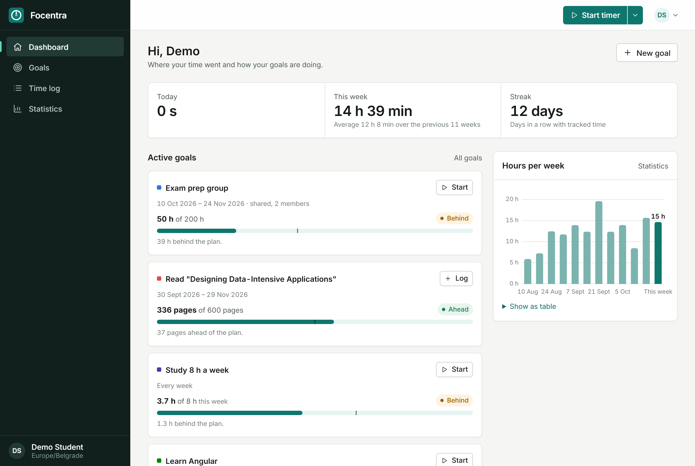
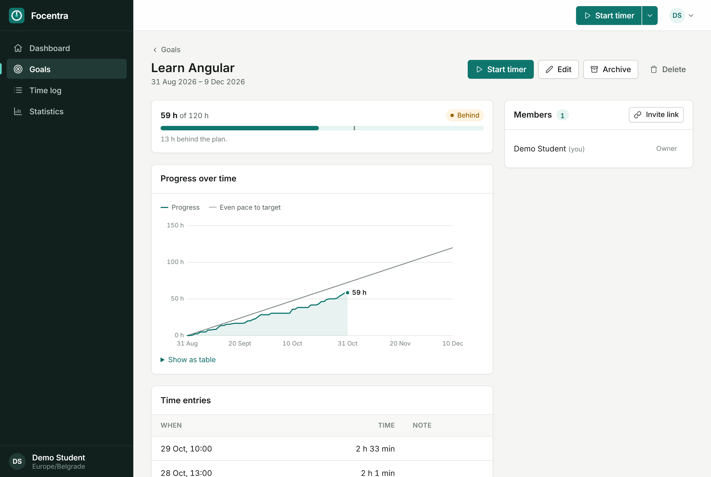
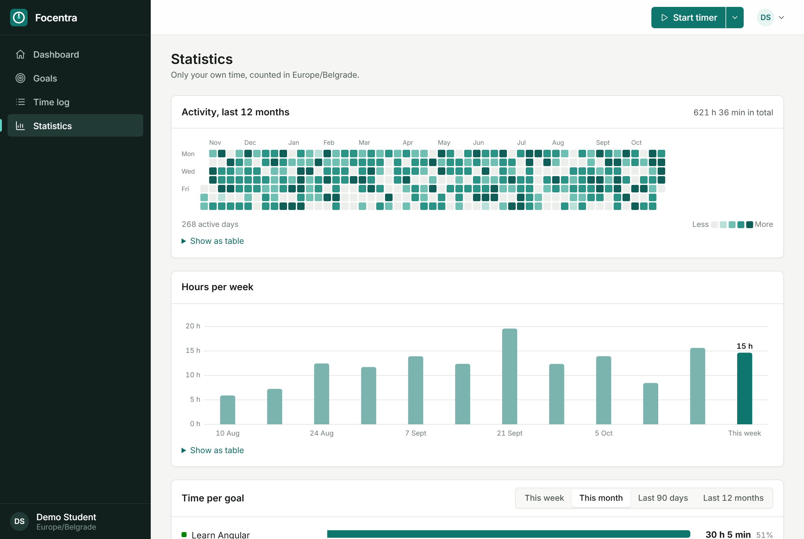
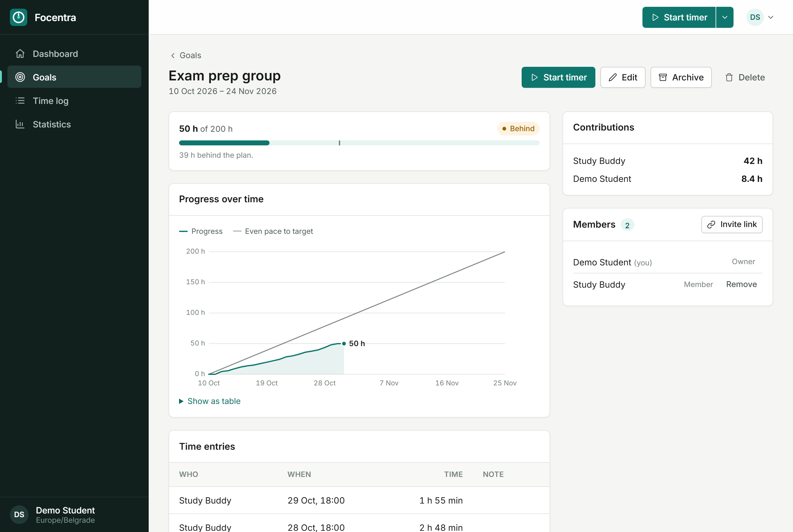
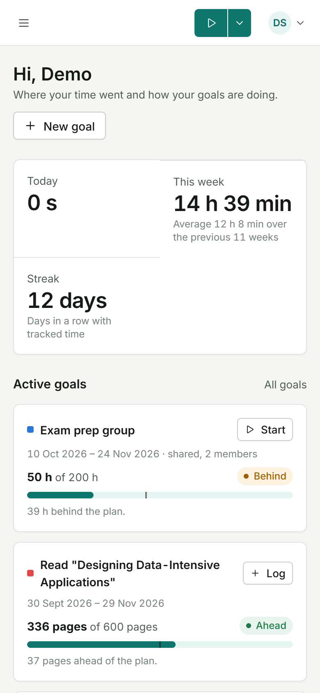

# Focentra Frontend

[](https://github.com/aleksa0206/Focentra-Frontend/actions/workflows/ci.yml)

Angular client for [Focentra-Backend](https://github.com/aleksa0206/Focentra-Backend): track study time against goals and see if you're on pace.

Live: [focentra.space](https://focentra.space)



| Goal detail | Statistics |
| --- | --- |
|  |  |
| Shared goal | Phone |
|  |  |

## Running locally

```bash
npm install
npm start          # http://localhost:4200, API on http://localhost:4000
npm test
npm run build
```

Set `FRONTEND_URL=http://localhost:4200` in the backend `.env`. With the backend demo data (`npm run seed:demo`) log in as `demo@focentra.local` / `Password123`.

## Screens

- Dashboard: today, this week, streak, active goals
- Goals: create, edit, archive, progress chart, members and invite links
- Time log: tracked time by period and goal, add or fix past entries
- Statistics: yearly heatmap, hours per week, time per goal
- Account: time zone, 2FA, data export, delete account

The timer is in the top bar on every page.

## Structure

```
src/app/
  core/       API services, auth, timer service
  shared/     charts (SVG), UI components, time zone and duration helpers
  layout/     shell with the timer, auth layout, 404
  features/   auth, dashboard, goals, entries, stats, invites, account
src/styles/   tokens, mixins, base styles
```

## Notes

- Everything is shown in the time zone from the user's profile, not the browser's, so days match the way the backend counts statistics. Conversion is done with `@date-fns/tz`.
- Charts are my own small SVG components instead of a chart library. Each one also has a "show as table" view.
- The timer reloads every minute while the tab is open, so starting it on the phone shows up on the laptop without websockets.
- No NgRx and no UI library, just `rxResource` and Angular CDK.
- It's a PWA, but it needs the network. Offline tracking isn't supported.

## Docker

The image serves the app with nginx, which proxies `/api` to the backend. It's started from the backend's `docker-compose.prod.yaml`. `npm run icons` regenerates the app icons.
